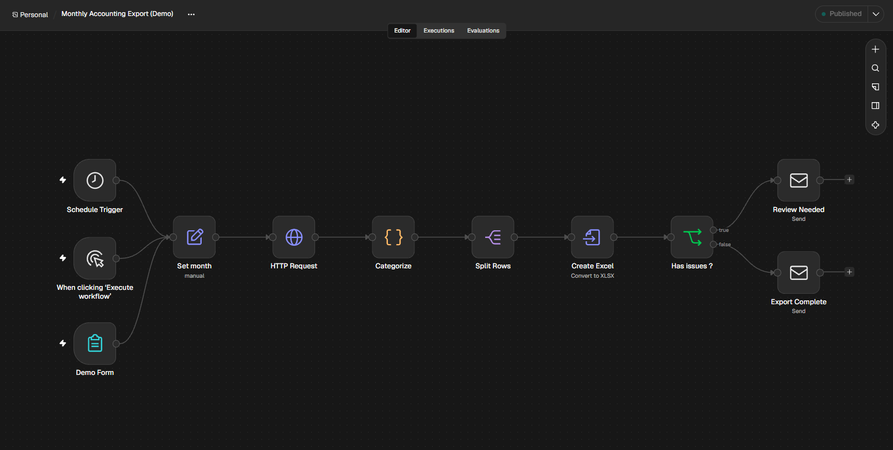
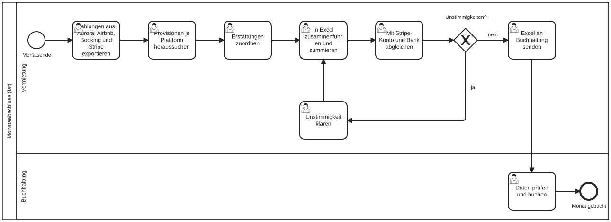
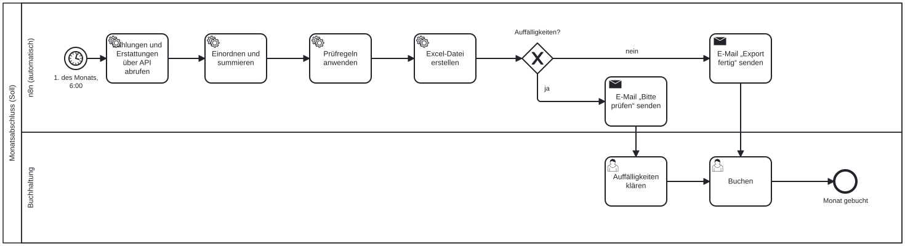
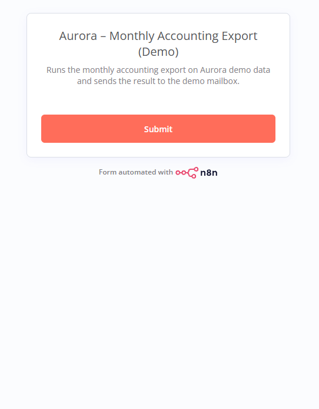
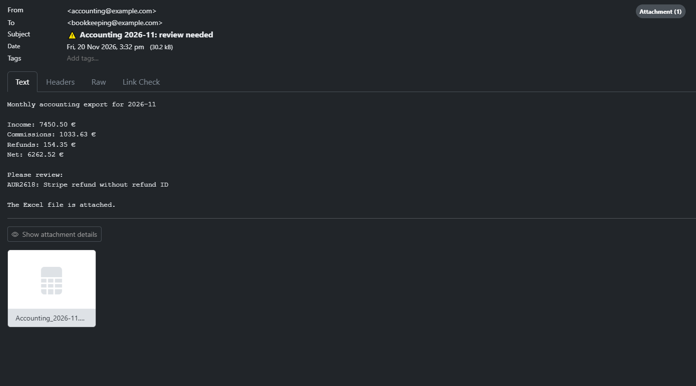
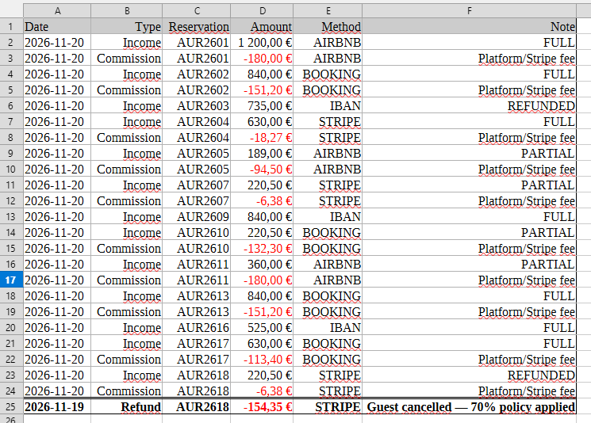

# Monatlicher Buchhaltungsexport – n8n-Workflow

*[English version](README.md)*

Automatischer Monatsabschluss für eine Ferienvermietung: n8n holt die Zahlungen und Erstattungen eines Monats über die API einer Buchungsplattform, ordnet sie ein, prüft sie auf Auffälligkeiten, erstellt eine Excel-Datei und verschickt sie per E-Mail. Was ein Mensch prüfen sollte, wird markiert.



## Ziel

Am Monatsende exportiert meist jemand die Buchungen von Hand, trennt Einnahmen von Plattformgebühren und Erstattungen, rechnet alles zusammen und schickt es an die Buchhaltung. Dieser Workflow erledigt das am 1. jedes Monats, ohne dass jemand eingreifen muss. **Die Maschine sortiert und rechnet. Ein Mensch schaut nur hin, wenn etwas auffällig ist.**

Die Datenquelle ist **[Aurora](https://aurora-apartment-skrbin.hr)**, eine mandantenfähige Buchungs- und Verwaltungsplattform, die ich entwickelt habe und für eine Ferienvermietung in der Familie produktiv betreibe.

## Ausprobieren

Eine öffentliche Demo läuft auf dem Demo-Mandanten von Aurora:

1. **[Demo-Formular](https://n8n.aurora-apartment-skrbin.hr/form/accounting-demo)** öffnen und auf **Submit** klicken.
2. **[Demo-Postfach](https://emails-demo.aurora-apartment-skrbin.hr)** öffnen. Die E-Mail mit der Excel-Datei kommt nach wenigen Sekunden an.

Die Demo liest nur Demo-Daten. Der n8n-Editor selbst bleibt privat.

## Prozess: vorher und nachher

Zuerst habe ich den manuellen Monatsabschluss als Ist-Prozess aufgenommen und danach den automatisierten Soll-Prozess entworfen (BPMN 2.0).

**Ist: manuell.** Jeder Schritt ist Handarbeit, und bei Unstimmigkeiten geht es zurück in die Schleife.



**Soll: mit n8n.** Sammeln, Rechnen und Prüfen laufen automatisch. Menschen buchen nur noch den Monat und klären Auffälligkeiten, wenn der Workflow welche meldet.



## Ablauf

| Schritt | Node | Aufgabe |
|---|---|---|
| 1 | **Schedule Trigger** | Läuft am 1. jedes Monats um 6:00 Uhr und exportiert den **Vormonat** |
| 1 | **Manual Trigger** / **Demo Form** | Start bei Bedarf, exportiert den **laufenden** Monat |
| 2 | **Set Month** | Bestimmt den Monat (`yyyy-MM`) |
| 3 | **HTTP Request** | Ruft den Export-Endpunkt von Aurora mit einem Mandanten-Token auf (nur Lesezugriff) |
| 4 | **Categorize** (Code) | Summiert Einnahmen, Provisionen und Erstattungen, berechnet den Nettobetrag, baut die Excel-Zeilen und sammelt Auffälligkeiten |
| 5 | **Split Rows** | Macht aus der Zeilenliste ein Item pro Zeile |
| 6 | **Create Excel** | Erstellt `Accounting_<Monat>.xlsx` |
| 7 | **Has Issues?** | Wählt die passende E-Mail |
| 8 | **Review Needed** / **Export Complete** | Verschickt die Summen und die Excel-Datei, bei Auffälligkeiten mit Liste |

## Einordnung

| Typ | Quelle | Vorzeichen |
|---|---|---|
| **Einnahme** | Eingegangener Betrag bei Zahlungen mit Status `FULL`, `PARTIAL`, `DEPOSIT` oder `REFUNDED` | + |
| **Provision** | Gebühr von Airbnb, Booking.com oder Stripe | − |
| **Erstattung** | Jede Erstattung, **mit ihrem eigenen Datum**, nicht dem der ursprünglichen Zahlung | − |

Eine später erstattete Zahlung zählt im Monat des Geldeingangs als Einnahme. Die Erstattung wird separat im Monat der Auszahlung gebucht. So wird nichts doppelt oder im falschen Monat abgezogen.

## Prüfregeln

Die E-Mail wechselt auf **„review needed“**, sobald eine Regel zutrifft:

| Regel | Begründung |
|---|---|
| Zahlung `PENDING` oder `FAILED` | Geld erwartet, aber nicht eingegangen |
| Mehr bezahlt als erwartet | Mögliche Doppelzahlung oder Eingabefehler |
| Stripe-Zahlung ohne Stripe-ID | Kein Abgleich mit dem Stripe-Konto möglich |
| Stripe-Erstattung ohne Refund-ID | Kein Abgleich mit dem Stripe-Konto möglich |

Der Demo-Mandant enthält immer eine Stripe-Erstattung ohne ID. Die Demo zeigt deshalb immer den Prüfzweig.

## Der Export-Endpunkt in Aurora

Für diesen Workflow habe ich in Aurora (Spring Boot) einen eigenen Endpunkt ergänzt:

```
GET /api/export/payments?month=2026-11
X-Export-Token: <Mandanten-Token>
```

```json
{
  "tenant": "DEMO",
  "month": "2026-11",
  "payments": [
    { "id": 5927, "reservationRef": "AUR2601", "createdAt": "2026-11-20T11:00:01Z",
      "paymentMethod": "AIRBNB", "paymentStatus": "FULL", "currency": "EUR",
      "amountExpected": 1200, "amountPaid": 1200, "commission": 180, "...": "..." }
  ],
  "refunds": [
    { "id": 941, "paymentId": 5939, "reservationRef": "AUR2618", "createdAt": "2026-11-19T00:00:00",
      "refundMethod": "STRIPE", "amountRefunded": 154.35, "reason": "Guest cancelled — 70% policy applied" }
  ]
}
```

**Sicherheitsentscheidungen:**
- **Ein Token pro Mandant.** Der Token bestimmt, welche Mandantendaten zurückkommen. Ein Mandanten-Header des Aufrufers wird ignoriert und lässt sich daher nicht fälschen.
- **Token-Vergleich in konstanter Zeit**, damit der Token nicht Zeichen für Zeichen über die Antwortzeit erraten werden kann.
- **Nur-Lese-Transaktion.** Der Endpunkt kann keine Daten ändern.
- **Nur intern erreichbar.** nginx antwortet von außen auf `/api/export/` mit 404, n8n ruft das Backend über das interne Docker-Netz auf.
- **Datensparsamkeit.** Gastnamen werden nicht exportiert, nur Reservierungsnummern.

## Infrastruktur

- n8n selbst gehostet mit Docker auf einem Hetzner-Server, neben Aurora
- nginx als Reverse Proxy, davor Cloudflare
- **Cloudflare Access** schützt den n8n-Editor. Öffentlich sind nur die Formular-Pfade.
- **Getrennte Workflows für Demo und Produktion**, jeweils mit eigenen Zugangsdaten. Die Demo schickt an Mailpit, die Produktion über Gmail.

## Validierung

Der Produktiv-Workflow wurde mit den echten Daten vom Juli 2026 ausgeführt, und die Summen wurden von Hand mit der Plattform abgeglichen: Einnahmen, Provisionen und Netto stimmten überein.

## Einrichtung

1. `monthly-accounting-export.json` in n8n importieren.
2. Zugangsdaten anlegen (sie sind nicht im Export enthalten):
   - **Header Auth** mit dem Namen `X-Export-Token` und dem eigenen API-Token
   - **SMTP** für den E-Mail-Versand
3. Die Node **HTTP Request** auf den eigenen Endpunkt zeigen lassen. Jede API, die das JSON-Format oben liefert, funktioniert.
4. E-Mail-Adressen anpassen und den Workflow veröffentlichen.

## Screenshots

| Demo-Formular | E-Mail |
|---|---|
|  |  |

**Excel-Datei**



## Technologien

n8n · JavaScript · Spring Boot · PostgreSQL · Docker · nginx · Cloudflare Access · Mailpit · Hetzner

## Lizenz

MIT
