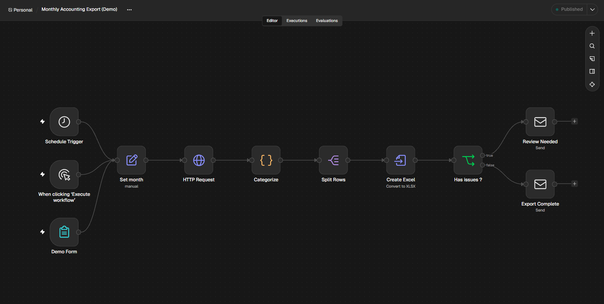
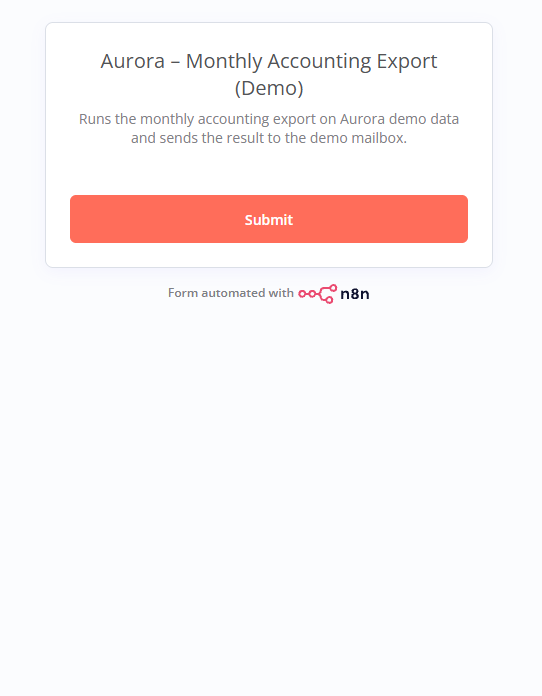
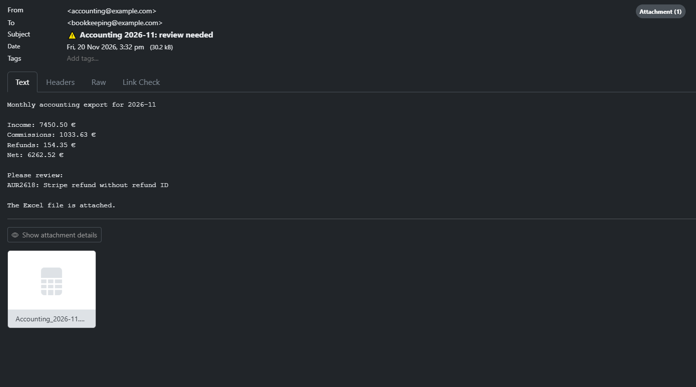
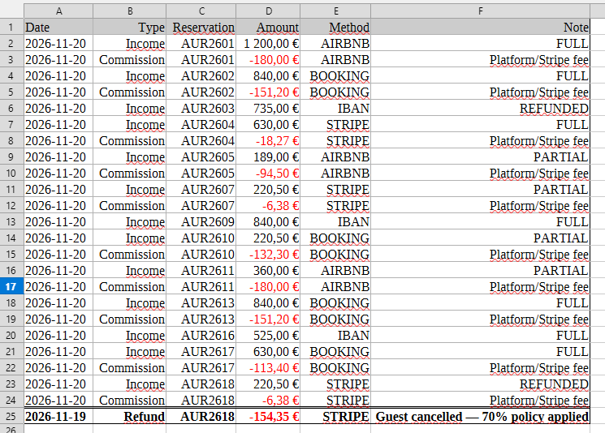

# Monthly Accounting Export – n8n Workflow

*[Deutsche Version](README.de.md)*

Automated month-end export for a property-rental business: n8n pulls the month's payments and refunds from a booking platform's API, categorizes them, runs consistency checks, builds an Excel file and emails it, flagging anything a human should review.



## Goal

At month end, someone usually exports bookings by hand, separates income from platform fees and refunds, adds everything up and sends it to the accountant. This workflow does that on the 1st of every month without anyone touching it. **The machine does the sorting and the maths. A human only looks when something is unusual.**

The data source is **[Aurora](https://aurora-apartment-skrbin.hr)**, a multi-tenant booking and property-management platform I built and run in production for a family rental business.

## Try it

A public demo runs on Aurora's demo tenant:

1. Open the **[demo form](https://n8n.aurora-apartment-skrbin.hr/form/accounting-demo)** and click **Submit**.
2. Open the **[demo mailbox](https://emails-demo.aurora-apartment-skrbin.hr)**. The email with the Excel file arrives within seconds.

The demo only reads demo data. The n8n editor itself stays private.

## How it works

| Step | Node | Purpose |
|---|---|---|
| 1 | **Schedule Trigger** | Runs on the 1st of every month at 6:00 and exports the **previous** month |
| 1 | **Manual Trigger** / **Demo Form** | Run on demand and export the **current** month |
| 2 | **Set Month** | Works out which month to export (`yyyy-MM`) |
| 3 | **HTTP Request** | Calls Aurora's read-only export endpoint with a tenant token |
| 4 | **Categorize** (Code) | Sums income, commissions and refunds, computes the net amount, builds the Excel rows and collects issues |
| 5 | **Split Rows** | Turns the row list into one item per row |
| 6 | **Create Excel** | Builds `Accounting_<month>.xlsx` |
| 7 | **Has Issues?** | Routes to the right email |
| 8 | **Review Needed** / **Export Complete** | Sends the totals and the Excel file, plus the list of issues when there are any |

## Categorization

| Type | Source | Sign |
|---|---|---|
| **Income** | Amount received on payments with status `FULL`, `PARTIAL`, `DEPOSIT` or `REFUNDED` | + |
| **Commission** | Airbnb, Booking.com or Stripe fee on the payment | − |
| **Refund** | Each refund, **dated by the refund itself**, not by the original payment | − |

A payment that was later refunded still counts as income in the month the money arrived. The refund is booked separately in the month it was paid out, so nothing is deducted twice or in the wrong month.

## Consistency checks

The email switches to **"review needed"** if any rule applies:

| Rule | Why |
|---|---|
| Payment `PENDING` or `FAILED` | Money expected but not received |
| Amount paid higher than amount expected | Possible double payment or data-entry error |
| Stripe payment without a Stripe ID | Cannot be reconciled with the Stripe account |
| Stripe refund without a refund ID | Cannot be reconciled with the Stripe account |

The demo tenant always contains one Stripe refund without an ID, so the demo always shows the "review needed" path.

## The Aurora export endpoint

I added a dedicated endpoint to Aurora (Spring Boot) for this workflow:

```
GET /api/export/payments?month=2026-11
X-Export-Token: <tenant token>
```

```json
{
  "tenant": "DEMO",
  "month": "2026-11",
  "payments": [
    { "id": 5927, "reservationRef": "AUR2601", "createdAt": "2026-11-20T11:00:01Z",
      "paymentMethod": "AIRBNB", "paymentStatus": "FULL", "currency": "EUR",
      "amountExpected": 1200, "amountPaid": 1200, "commission": 180, "...": "..." }
  ],
  "refunds": [
    { "id": 941, "paymentId": 5939, "reservationRef": "AUR2618", "createdAt": "2026-11-19T00:00:00",
      "refundMethod": "STRIPE", "amountRefunded": 154.35, "reason": "Guest cancelled — 70% policy applied" }
  ]
}
```

**Security decisions:**
- **One token per tenant.** The token decides which tenant's data comes back. A tenant header from the caller is ignored, so it cannot be spoofed.
- **Constant-time token comparison**, so the token cannot be guessed character by character from response times.
- **Read-only transaction.** The endpoint cannot change any data.
- **Internal only.** nginx returns 404 for `/api/export/` from outside, and n8n calls the backend over the internal Docker network.
- **Data minimization.** Guest names are not exported, only reservation references.

## Infrastructure

- n8n self-hosted with Docker on a Hetzner server, next to Aurora
- nginx reverse proxy, Cloudflare in front
- **Cloudflare Access** protects the n8n editor. Only the form paths are public.
- **Separate demo and production workflows**, each with its own credentials. The demo sends to Mailpit, production sends via Gmail.

## Validation

The production workflow was run against real July 2026 data, and the totals were checked by hand against the platform: income, commissions and net all matched.

## Setup

1. Import `monthly-accounting-export.json` into n8n.
2. Create the credentials (they are not part of the export):
   - **Header Auth** with name `X-Export-Token` and your API token
   - **SMTP** for sending the email
3. Point the **HTTP Request** node at your own endpoint. Any API that returns the JSON shape above works.
4. Adjust the email addresses and publish the workflow.

## Screenshots

| Demo form | Email |
|---|---|
|  |  |

**Excel file**



## Tech stack

n8n · JavaScript · Spring Boot · PostgreSQL · Docker · nginx · Cloudflare Access · Mailpit · Hetzner

## License

MIT
